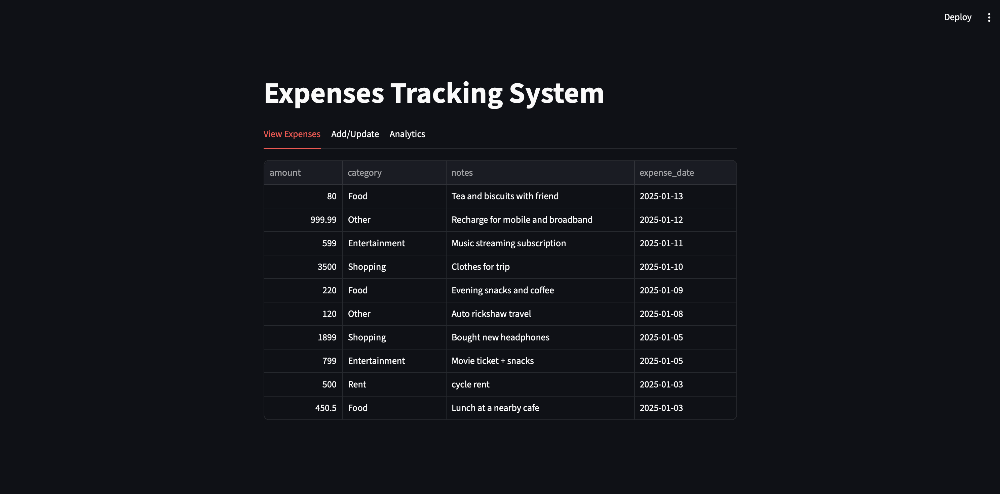
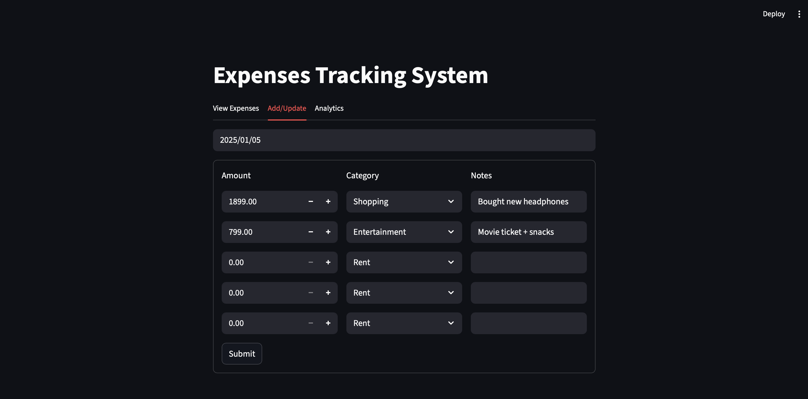
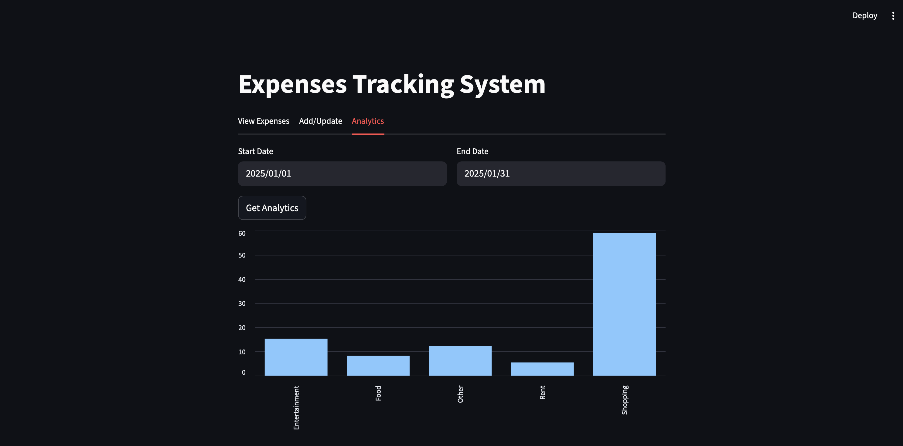
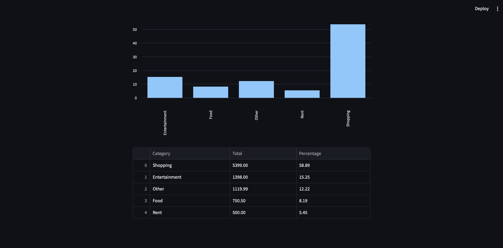

# Expense Tracking System

A full-stack web application that enables users to efficiently track, manage, and analyze personal expenses with real-time insights and intuitive data visualization.

---
## Video Explanation
<iframe src="https://www.linkedin.com/embed/feed/update/urn:li:ugcPost:7400923550749966336?collapsed=1" height="542" width="504" frameborder="0" allowfullscreen="" title="Embedded post"></iframe>

---
## Web Page Captures






---
## Key Features

- **Daily Expense Management**: Add, update, and delete multiple expenses per day with categorization
- **Real-Time Data Synchronization**: Frontend-backend communication via RESTful API architecture
- **Expense Analytics Dashboard**: Visual breakdown of spending patterns with percentage-based category analysis
- **Date-Based Filtering**: Query expenses by specific dates or date ranges for targeted insights
- **Batch Operations**: Handle up to 5 expense entries simultaneously for streamlined data entry
- **Interactive UI**: Clean, tab-based interface with immediate feedback on all operations
- **Category-Based Organization**: Predefined categories (Rent, Food, Shopping, Entertainment, Other) for consistent tracking

---

## System Architecture

The application follows a **three-tier architecture** with clear separation of concerns:

### Architecture Overview
```
┌─────────────────┐         ┌─────────────────┐         ┌─────────────────┐
│   Frontend      │  HTTP   │   Backend       │  SQL    │   Database      │
│   (Streamlit)   │ ◄─────► │   (FastAPI)     │ ◄─────► │   (MySQL)       │
│                 │         │                 │         │                 │
│  - UI Components│         │  - REST API     │         │  - Expenses     │
│  - State Mgmt   │         │  - Validation   │         │    Table        │
│  - API Calls    │         │  - Business     │         │  - Persistence  │
└─────────────────┘         └─────────────────┘         └─────────────────┘
```

### Design Decisions

- **FastAPI Backend**: Chosen for automatic API documentation (OpenAPI), Pydantic validation, and high performance with async support
- **Streamlit Frontend**: Rapid prototyping with built-in state management and data visualization components
- **MySQL Database**: Relational model ensures data integrity and supports complex aggregation queries
- **Modular UI Components**: Each tab is isolated in separate modules for maintainability and scalability
- **RESTful API Design**: Standard HTTP methods (GET, POST) for intuitive endpoint structure
- **Date-Based Partitioning**: Allows flexible expense updates without complex state management

---

## Tech Stack

### Frontend
- **Streamlit** - Interactive web UI framework with built-in components
- **Pandas** - Data manipulation and tabular display
- **Requests** - HTTP client for API communication

### Backend
- **FastAPI** - Modern Python web framework with automatic API docs
- **Pydantic** - Data validation and serialization
- **Uvicorn** - ASGI server for async request handling

### Database
- **MySQL** - Relational database for structured expense data
- **mysql-connector-python** - Native Python driver for MySQL connectivity


---

## Installation & Setup

### Prerequisites
- Python 3.8+
- MySQL Server 8.0+
- pip package manager

### Step 1: Clone the Repository
```bash
git clone <repository-url>
cd expense-tracking-system
```

### Step 2: Install Dependencies
```bash
pip install -r requirements.txt
```

### Step 3: Configure Database
```sql
-- Create database
CREATE DATABASE expense_manager;

-- Create expenses table
USE expense_manager;
CREATE TABLE expenses (
    id INT AUTO_INCREMENT PRIMARY KEY,
    expense_date DATE NOT NULL,
    amount FLOAT NOT NULL,
    category VARCHAR(50) NOT NULL,
    notes TEXT,
    INDEX idx_date (expense_date)
);
```

### Step 4: Configure Environment Variables
Create a `.env` file in the root directory (copy from `.env.example`):
```bash
cp .env.example .env
```

Update the `.env` file with your configuration:
```env
# Backend API Configuration
API_URL=http://127.0.0.1:8000

# Database Configuration
DB_HOST=localhost
DB_USER=root
DB_PASSWORD=your_password_here
DB_NAME=expense_manager
DB_PORT=3306

# Server Configuration
BACKEND_HOST=127.0.0.1
BACKEND_PORT=8000
```

### Step 5: Start the Backend Server
```bash
cd backend
uvicorn main:app --reload --host 127.0.0.1 --port 8000
```

### Step 6: Launch the Frontend (New Terminal)
```bash
cd frontend
streamlit run app.py
```

Access the application at `http://localhost:8501`

---

## Usage / Workflow

### 1. View All Expenses
- Navigate to **"View Expenses"** tab
- See all recorded expenses sorted by date (descending)
- Data displayed in interactive table format

### 2. Add/Update Expenses
- Select **"Add/Update"** tab
- Choose a date using the date picker
- System automatically loads existing expenses for that date
- Add up to 5 expense entries simultaneously
- Click **Submit** to persist changes
- Backend performs atomic operation: deletes old entries and inserts new ones

### 3. Analyze Spending Patterns
- Go to **"Analytics"** tab
- Select start and end dates for analysis period
- Click **"Get Analytics"**
- View:
  - Bar chart showing percentage breakdown by category
  - Detailed table with total amounts and percentages
  - Categories sorted by spending percentage (highest first)

### API Endpoints

| Method | Endpoint | Description |
|--------|----------|-------------|
| `GET` | `/expenses` | Retrieve all expenses |
| `GET` | `/expenses/{date}` | Get expenses for specific date |
| `POST` | `/expenses/{date}` | Add/Update expenses for date |
| `POST` | `/analytics` | Get spending analytics for date range |

---

## Project Structure

```
expense-tracking-system/
│
├── backend/
│   ├── main.py              # FastAPI application and route handlers
│   └── database.py          # MySQL connection and CRUD operations
│
├── frontend/
│   ├── app.py               # Main Streamlit app with tab navigation
│   ├── add_update_ui.py     # Expense entry and update interface
│   ├── view_expenses_ui.py  # Display all expenses in table format
│   └── analytics_ui.py      # Data visualization and insights
│
├── requirements.txt         # Python dependencies
├── .env.example             # .env
└── README.md                # Project documentation
```

### Key Files Explained
- **`main.py`**: Defines Pydantic models and API endpoints with response validation
- **`database.py`**: Encapsulates all SQL operations with connection pooling
- **`app.py`**: Entry point for frontend with tab-based navigation structure
- **`add_update_ui.py`**: Form handling with session state management for dynamic inputs

---

## Security & Best Practices

### Current Implementation
- **Input Validation**: Pydantic models enforce type safety and data constraints
- **Parameterized Queries**: SQL injection prevention through prepared statements
- **Error Handling**: Graceful degradation with user-friendly error messages
- **Connection Management**: Proper cursor and connection closing to prevent leaks

### Performance Optimizations
- **Database Indexing**: Date-based index on `expense_date` column for faster queries
- **Connection Pooling**: Reusable database connections (via `get_connection()`)
- **Aggregation at Database Layer**: Category summaries computed in SQL rather than application layer
- **Batch Processing**: Support for multiple expense entries in single API call

---

## Future Enhancements


- **User Authentication**: Multi-user support with secure login (JWT/OAuth2)
- **Data Export**: CSV/PDF export functionality for tax reporting
- **Advanced Filters**: Search by category, amount range, and keywords in notes
- **Recurring Expenses**: Template system for monthly bills and subscriptions
- **Budget Tracking**: Set category-wise budgets with overspending alerts

---

## Technical Highlights

- **Type-Safe API Design**: Leverages Pydantic for automatic request/response validation
- **Separation of Concerns**: Clear boundaries between presentation, business logic, and data layers
- **RESTful Principles**: Stateless API design following HTTP standards
- **Responsive UI**: Real-time feedback on all CRUD operations
- **Scalable Architecture**: Modular design supports easy feature additions

---

**Built with Python • FastAPI • Streamlit • MySQL**
